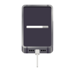

<div align="center">
  

  # Corer

  **Restore and update Apple devices from the GNOME desktop**

  [](https://github.com/tecncr/corer/releases/latest)
  [](COPYING)
</div>

Corer is a libadwaita front end for
[idevicerestore](https://github.com/libimobiledevice/idevicerestore). Connect an
Apple device, pick a version and choose whether to keep or erase its content. Corer downloads the firmware, walks the device through the
process and shows where it is at every stage.

Corer is not affiliated with or endorsed by Apple Inc.

## Features

- **Update or restore**: install a new version keeping your data, or erase the
  device and start fresh
- **Firmware on demand**: lists the versions Apple currently signs for the
  device, downloads the one you pick, resumes interrupted downloads and
  verifies them
- **Bring your own IPSW**: use a firmware file you already have, with a
  warning when it does not match the device or is no longer signed
- **Any device state**: works with devices in normal, recovery and DFU mode
- **Not only phones**: iPhone, iPad, iPod touch and Apple TV, as well as Mac
  computers with Apple silicon in DFU mode
- **Recovery mode at a click**: put a device into recovery mode or get it back
  out
- **SHSH blobs**: save them for the selected version
- **Logs you can use**: every session is logged in full, ready to copy or save
  when something goes wrong
- **Advanced options**: the idevicerestore switches that matter live in
  Preferences

## How it works

Corer bundles the whole libimobiledevice stack, built from the `master`
branches. Tagged releases are rare, and distribution packages are often too
old for current devices and system versions.

A restore makes the device disconnect and reconnect several times as it moves
from normal mode to recovery mode and on to restore mode. Corer keeps track of
it across those changes, including inside the Flatpak sandbox, where the
system's `usbmuxd` socket cannot be followed directly.

## Installing

Corer is distributed as a Flatpak bundle on the
[Releases page](https://github.com/tecncr/corer/releases/latest). Download the
file for your machine, `corer-<version>-x86_64.flatpak` for most PCs or
`corer-<version>-aarch64.flatpak` for 64-bit ARM, along with `SHA256SUMS`.

Check the download, then install the GNOME runtime from Flathub and the bundle
itself:

```sh
sha256sum -c --ignore-missing SHA256SUMS
flatpak remote-add --user --if-not-exists flathub https://dl.flathub.org/repo/flathub.flatpakrepo
flatpak install --user flathub org.gnome.Platform//51
flatpak install --user corer-v0.2.0-x86_64.flatpak
```

Corer then shows up in the app grid, or can be started with
`flatpak run com.tecncr.Corer`. The bundle includes every translation, so
Corer follows your system language. To update, download the bundle from a newer
release and install it the same way. To remove it:

```sh
flatpak uninstall --user com.tecncr.Corer
```

The first time a device is in recovery or DFU mode, Corer offers to install the
udev rule it needs to reach it (see [Device access](#device-access)).

## Building

Flatpak is the supported way to build and run Corer. The manifest builds the
whole libimobiledevice stack from the `master` branches, because tagged
releases are rare and distribution packages are often too old for current
devices.

### GNOME Builder

Open the project folder and press Run. Builder picks up
`com.tecncr.Corer.Devel.json`.

### Command line

```sh
flatpak install --user flathub org.gnome.Platform//51 org.gnome.Sdk//51
flatpak-builder --user --install --force-clean .flatpak/app com.tecncr.Corer.json
flatpak run com.tecncr.Corer
```

Use `com.tecncr.Corer.Devel.json` for a development build that installs next
to the stable one with its own icon and ID.

Local builds follow Flatpak's convention and put translations in a separate
`com.tecncr.Corer.Locale` extension. Only the languages in
`flatpak config --user languages` get installed, so run
`flatpak config --user --set languages '*'` before building to get all of them.
To try a language without changing your system language, run
`flatpak run --env=LANGUAGE=fr com.tecncr.Corer`. Release bundles include
every translation in the app itself, because a single-file bundle cannot
carry the extension.

### Meson only

For CI, or to run against the tools installed on the system (`idevicerestore`,
`idevice_id`, `ideviceinfo` and `irecovery` must be in `PATH`):

```sh
meson setup build
meson compile -C build
meson test -C build
meson install -C build
```

Runtime dependencies: Python 3 with PyGObject, GTK 4 and libadwaita 1.8 or
newer.

## Device access

Corer talks to devices through `usbmuxd`. It uses the one from the system when
there is one and starts its own copy otherwise.

The system `usbmuxd` usually exits when the last device goes away and starts
again when one shows up. Inside the sandbox Corer reaches it through
`systemd-socket-proxyd` in the user session and its own relay, so the bundled
tools keep seeing the device while the daemon restarts.

Devices in recovery and DFU mode are accessed directly over USB, which needs a
udev rule. Corer offers to install it when it is missing. To do it by hand:

```sh
sudo cp data/71-corer-apple-devices.rules /etc/udev/rules.d/
sudo udevadm control --reload-rules
sudo udevadm trigger --subsystem-match=usb --attr-match=idVendor=05ac
```

## Firmware cache

Downloaded firmware is kept in the `corer` folder of the cache directory:
`~/.var/app/com.tecncr.Corer/cache/corer` for the Flatpak, `~/.cache/corer`
otherwise. It can be emptied from Preferences.

## Translating

Corer uses gettext. To add a language, add its code to `po/LINGUAS` and create
the catalog from the template:

```sh
meson compile -C build corer-pot          # refresh po/corer.pot
msginit -i po/corer.pot -o po/es.po -l es  # start a new translation
meson compile -C build corer-update-po    # merge new strings into all catalogs
```

## Acknowledgements

Corer would not exist without the [libimobiledevice](https://libimobiledevice.org)
project, which does all the real work. Bundled symbolic icons come from the
[Adwaita icon theme](https://gitlab.gnome.org/GNOME/adwaita-icon-theme).

## License

GPL-3.0-or-later. See [COPYING](COPYING).
